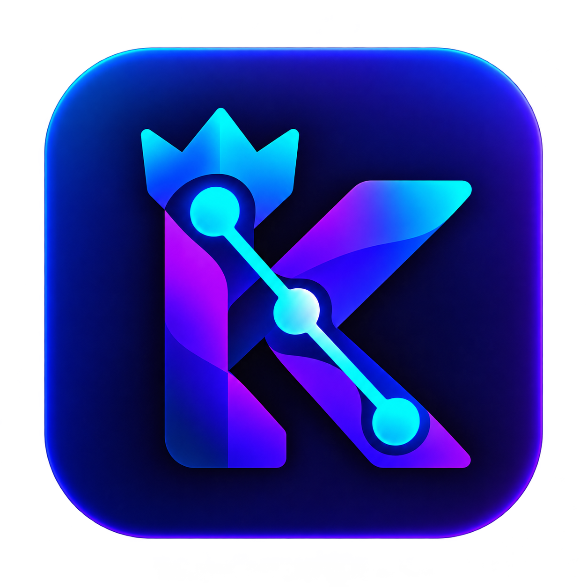

<h1 align="center">
  
  king-dsh
</h1>

<p align="center">
  A local-first, cross-platform desktop app for
  <a href="https://github.com/deepseek-ai/deepseek-harness">DeepSeek Harness</a>.
</p>

<p align="center">
  <a href="README.md">English</a> · <a href="README.zh.md">简体中文</a> · <a href="README.ja.md">日本語</a> · <a href="README.ru.md">Русский</a> · <a href="README.es.md">Español</a> · <a href="README.pt.md">Português</a>
</p>

<p align="center">
  <a href="LICENSE"></a>
  
  
</p>


<p align="center"><strong>Use official DeepSeek models or mainstream third-party providers, manage portable Agent presets, continue Harness sessions from your phone, and turn source material into editable PPTX decks.</strong></p>

king-dsh is a downstream customization of [DSH Desktop](https://github.com/dataelement/dsh-desktop) that packages the local DeepSeek Harness experience as an installed desktop application. It keeps a separate application identity and data directory so it can coexist with the upstream app.

> [!IMPORTANT]
> king-dsh is an early preview built on the rapidly evolving `@deepseek-ai/dsh@0.2.0-rc.2`. Local packages are unsigned development builds unless you configure your own signing identity.

## Local package

Run `npm run package:local` to build an unsigned development installer for the current machine. On macOS, `npm run package:local:install` also preserves the installed app as a timestamped backup, installs the new package, and launches it. The wrapper auto-detects the optional local proxy at `127.0.0.1:7890`; use `npm run package:local -- --network direct` to bypass it. Explicit target commands such as `package:dev:mac:arm64`, `package:dev:mac:x64`, and `package:dev:win` remain available. Development packages disable the official updater; upstream changes are integrated through the repository's upstream-sync workflow before rebuilding.

## Community

<p align="center">
  Scan the QR code below with WeChat to join the DSH Desktop community group.<br />
  <br />
  Prefer Discord? <a href="https://discord.gg/7Xgf3qe3Qp">Join the DSH Desktop Discord community</a>.
</p>

## What king-dsh adds

DeepSeek Harness already provides the Agent runtime and Web UI. king-dsh carries the DSH Desktop host capabilities plus downstream branding and customization:

- Starts and stops Harness without requiring a separate CLI or browser tab
- Uses the native system directory picker to add and manage project workspaces
- Supports official DeepSeek models and mainstream third-party model providers
- Imports and exports complete custom Agent presets as portable [`.dshpreset` packages](docs/preset-packages.md), with conflict checks and a trust warning before installation
- Turns source material into editable PPTX decks through the built-in PPT mode
- Includes offline DOCX, PPTX and XLSX skills with bundled Python libraries on macOS and Windows
- Preserves profiles, plugins, workspaces, sessions, and model settings across app upgrades
- Detects startup and frontend plugin failures, keeps diagnostics in `harness.log`, and offers guided recovery actions
- Provides a non-destructive Safe Mode that temporarily blocks third-party plugins
- Lets a paired phone continue sessions over the local network or an optional temporary public tunnel
- Checks for desktop updates and keeps download and installation under user control
- Adapts native menus, titlebar behavior, window focus, theme, and application branding for macOS and Windows

## PPT generation

Enable the **PPT** button, choose a template, and describe the deck you need. The built-in catalog includes **16 templates and 192 layouts** with editable PPTX output. Previews use English; decks can use English or Chinese, with corresponding font settings. Preview language does not determine output language.

PPT is preinstalled, and its automatic instructions apply only to sessions where the PPT button is enabled. See the [PPT runtime guide](packages/ppt-runtime/README.md) for templates, validation, and source acknowledgments.

## Phone access

Choose **Connect Phone…** from the `Harness` menu and scan the pairing code.

- On Wi-Fi, scanning connects immediately.
- Over the internet tunnel, the phone enters a 6-digit pairing password shown only on the computer. By default the password is temporary (5 minutes, memory only). A durable password is created only after you opt in on the Connect Phone window.

Harness itself remains on a random `127.0.0.1` port. Phone access uses a separate paired bridge. Cloudflare Quick Tunnel is the usual long-lived remote path. Free Pinggy is the fallback when Cloudflare is unavailable (for example in mainland China) and expires after about 60 minutes. Disconnecting the phone from the desktop invalidates the mobile session.

If Cloudflare fails to start, the app tries Pinggy. If a Cloudflare pairing link appears but your phone cannot open it, choose **Can’t open? Try another link** to switch to Pinggy.

## Safe Mode and recovery

If a third-party plugin interferes with startup or rendering, king-dsh can identify the implicated plugin from runtime and frontend evidence and open a guided recovery surface.

Choose **Restart as Safe Mode…** from the `Harness` menu to start an isolated profile containing only official core bundles. The Agent, sessions, model settings, and workspaces remain available while third-party plugins from the normal profile stay blocked. You can remove selected plugins or return to a normal launch from the Safe Mode banner.

Recovery screens check for compatible plugin updates. When available, you can upgrade an affected plugin; Safe Mode also offers batch upgrades. For help, hover over **WeChat group** to display its QR code, or click **Discord** to open the community.

If the normal interface cannot be reached, start king-dsh with `--safe-mode`. On macOS:

```sh
open -a "king-dsh" --args --safe-mode
```

## Local data and security

- The Harness Web UI is served only on a random loopback port.
- The renderer has no Node.js privileges and uses context isolation and sandboxing.
- Webviews, untrusted in-app navigation, and unexpected permission requests are blocked.
- External web links open in the system browser.
- User profiles and sessions live under Electron's per-user application data directory, not inside the installed app.
- Phone access requires a short-lived pairing token. Wi-Fi connects on scan; the internet tunnel also requires the pairing password shown on the computer.

## Platform support

| Platform | Distribution | Status |
| --- | --- | --- |
| macOS Apple Silicon | Signed and notarized DMG/ZIP | Supported |
| macOS Intel | Signed and notarized DMG/ZIP | Supported |
| Windows x64 | Code-signed NSIS installer | Supported |
| Windows ARM64 | — | Not currently supported |
| Linux | — | Not currently supported |

Harness includes target-native dependencies, so every release artifact is built on the matching operating system and architecture.

## Development and architecture

Contributions are welcome. Start with the public engineering documentation:

- [Development guide](docs/development.md) — setup, validation, patch maintenance, and target-native packaging
- [Architecture](docs/architecture.md) — runtime flow, persistent data, security boundaries, recovery, mobile access, and updates
- [Release runbook](docs/release-runbook.md) — signing and publication controls
- [Preset package format](docs/preset-packages.md) — portable Agent preset contract

Before submitting a change, run `npm test`, `npm run typecheck`, and `npm run build`, then exercise the affected real application flow. Never include real API keys in issues, logs, screenshots, or test data.

## Friends

[dsh-market](https://github.com/dsh-market/dsh-market) is the community plugin market for DeepSeek Harness. Browse and search plugins, preview screenshots, install or update packages, enable or disable plugins, and switch themes from the Harness interface.

## License

king-dsh is open source under the [MIT License](LICENSE).

DeepSeek Harness, DSH Desktop, and their dependencies remain subject to their respective upstream licenses and trademark policies.
